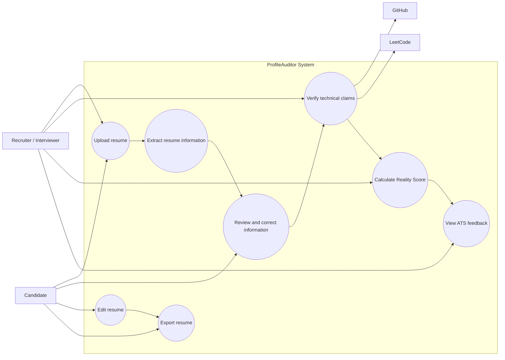
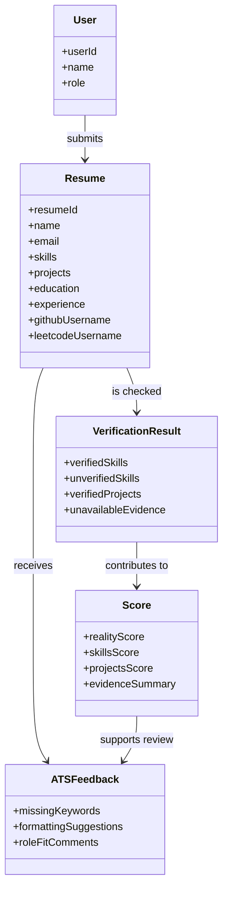
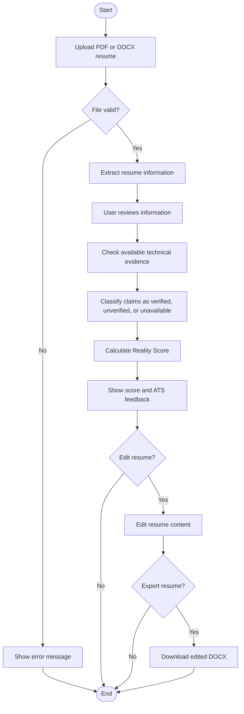
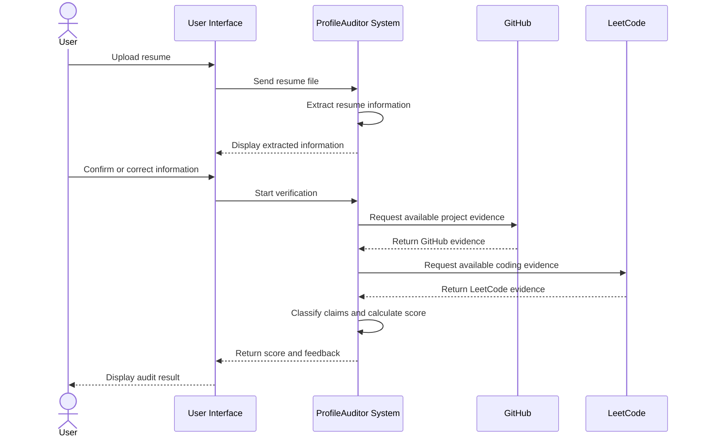

# ProfileAuditor UML Diagrams

## Introduction

Unified Modeling Language (UML) diagrams are used to describe the proposed ProfileAuditor system before development. They provide a simple visual view of the users, system activities, main classes, and communication between system parts.

The following diagrams are included:

1. **Use case diagram:** Shows the users and the functions they expect from the system.
2. **Class diagram:** Shows the main data classes and their relationships.
3. **Activity diagram:** Shows the steps followed during a resume audit.
4. **Sequence diagram:** Shows the order of communication during an audit.

These diagrams are design models for the proposed academic project. They are not implementation diagrams.

## 1. Use Case Diagram

### Explanation

The recruiter or interviewer reviews the audit results. The candidate provides or corrects resume information. GitHub and LeetCode are external sources that may provide supporting evidence.

## 2. Class Diagram

### Explanation

The `Resume` class stores the information extracted from a document. `VerificationResult` stores the evidence found for skills and projects. `Score` represents the calculated result, while `ATSFeedback` contains suggestions for improving the resume.

## 3. Activity Diagram

### Explanation

The activity begins when a user uploads a resume. The system validates and extracts the information, allows the user to review it, checks available evidence, and displays the score and feedback. The user may then edit and export the resume.

## 4. Sequence Diagram

### Explanation

The sequence diagram shows the order of communication between the user interface, the proposed system, and the external public-profile sources. The system processes the resume, requests available evidence, calculates the result, and displays the feedback.

## Conclusion

These UML diagrams provide a basic design of the proposed ProfileAuditor system. They describe the required users, activities, classes, and interactions before implementation begins. The diagrams can be refined after stakeholder requirements are approved.
