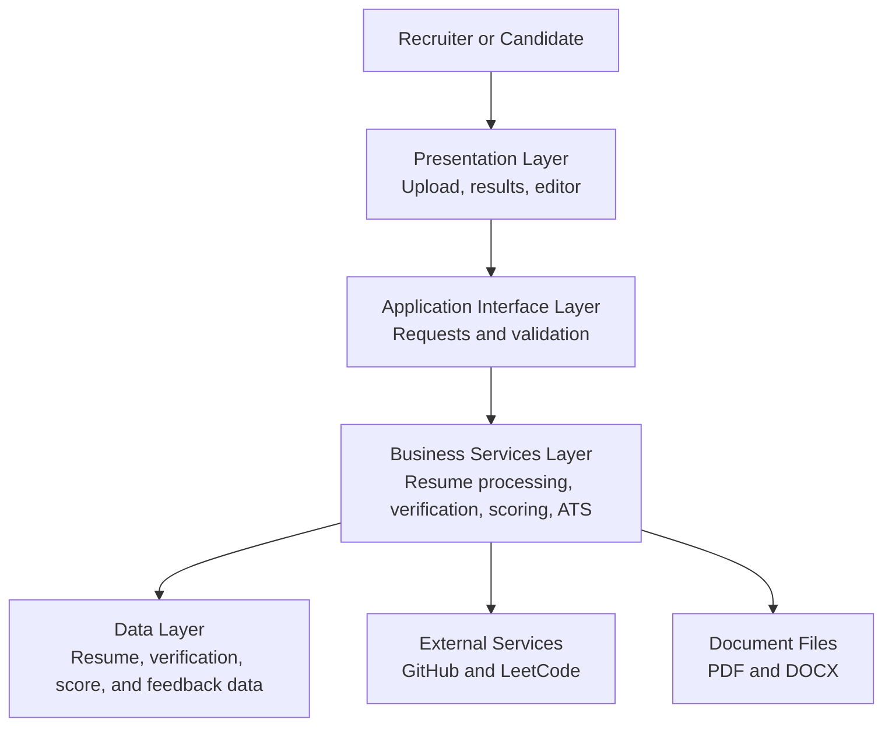

# ProfileAuditor Architectural Design

**Project stage:** Before development
**Architecture style:** Layered architecture with simple service boundaries

## 1. Introduction

Architectural design describes the main parts of the proposed ProfileAuditor system and the way those parts communicate. A layered architecture is suitable for this academic project because it separates user interaction, application logic, data, and external services.

The design is also microservice-inspired because major activities such as resume processing, verification, scoring, and ATS analysis are kept as separate responsibilities. They do not need to be separate deployed applications for the first version.

## 2. Architectural Diagram

## 3. Description of Layers

### 3.1 Presentation Layer

This layer provides the screens used by the recruiter or candidate.

Main responsibilities:

- Upload a PDF or DOCX resume.
- Display extracted resume information.
- Show verification results and the Reality Score.
- Provide ATS feedback and resume editing.
- Show clear success, progress, and error messages.

### 3.2 Application Interface Layer

This layer receives requests from the presentation layer and checks whether the requests are valid.

Main responsibilities:

- Accept resume uploads and user input.
- Validate file types and required information.
- Send requests to the correct business service.
- Return results and understandable error messages.

### 3.3 Business Services Layer

This layer contains the main logic of the proposed system.

| Service | Responsibility |
|---|---|
| Resume Processing | Extract text and important fields from a resume. |
| Verification | Compare technical claims with available public evidence. |
| Scoring | Calculate the Reality Score and its breakdown. |
| ATS Analysis | Provide resume quality and keyword feedback. |
| Role Matching | Compare resume information with a job description. |
| Document Editing | Support corrections and DOCX export. |

Keeping these responsibilities separate makes the design easier to understand and test.

### 3.4 Data Layer

This layer represents the information used by the proposed system.

It may contain:

- Resume details and extracted text.
- Technical skills and project information.
- Verification results.
- Reality Score and score breakdown.
- ATS feedback and editing data.

The data layer should not contain user-interface logic.

### 3.5 External Services Layer

This layer represents services outside ProfileAuditor.

- **GitHub:** Provides available repository and project evidence.
- **LeetCode:** Provides available coding-activity evidence.
- **Document tools:** Support reading and creating PDF or DOCX files.

If an external service is unavailable, the system should show an unavailable status instead of treating the missing data as proof that a claim is false.

## 4. Basic Data Flow

1. The user uploads a resume through the presentation layer.
2. The interface layer validates the file and sends it for processing.
3. The business layer extracts the resume information.
4. The user reviews and corrects the extracted information.
5. The verification service checks available public evidence.
6. The scoring service calculates the Reality Score.
7. The ATS service provides resume feedback.
8. The presentation layer displays the results to the user.

## 5. Design Principles

- Each layer should have a clear responsibility.
- The presentation layer should not calculate the official score.
- Verification, scoring, and ATS analysis should remain separate activities.
- External service failures should not hide available resume information.
- The system should support human review rather than automatic hiring decisions.
- The design should be simple enough to implement and test as an academic project.

## 6. Conclusion

The proposed layered architecture gives ProfileAuditor a clear structure for development. It separates user interaction, request handling, business logic, data, and external services. The service boundaries also allow individual responsibilities to be improved later without making the initial academic project unnecessarily complex.
