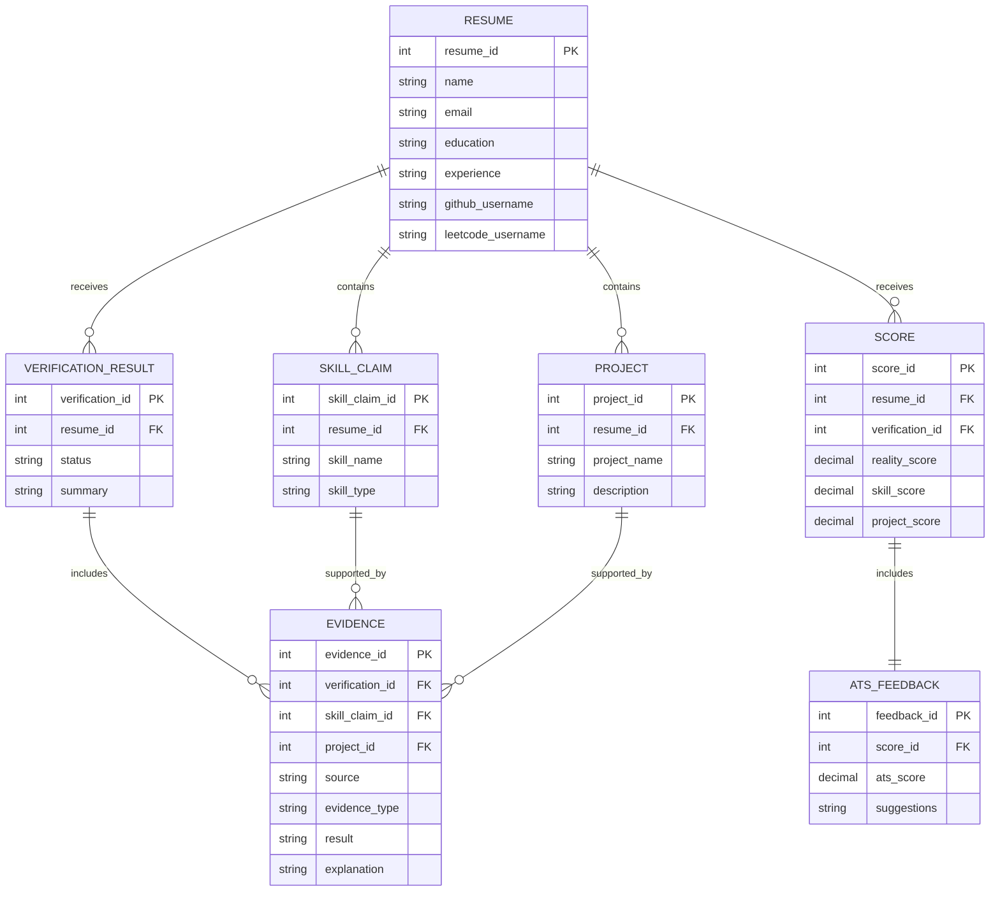

# ProfileAuditor ER Diagram and Relational Schema

**Project stage:** Before development
**Design type:** Proposed database design

## 1. Introduction

An Entity-Relationship (ER) diagram shows the main data entities in the proposed ProfileAuditor system and the relationships between them. The relational schema converts these entities into tables with primary keys and foreign keys.

This design stores resume information, technical claims, verification evidence, scores, and ATS feedback. It is a simple academic design and can be refined after stakeholder requirements are approved.

## 2. Entity-Relationship Diagram

## 3. Entity Descriptions

| Entity | Description |
|---|---|
| Resume | Stores basic candidate and resume information. |
| Skill Claim | Stores a technical or soft skill mentioned in a resume. |
| Project | Stores projects described in a resume. |
| Verification Result | Stores the result of checking claims against available public evidence. |
| Evidence | Stores the source and explanation supporting a verification result. |
| Score | Stores the Reality Score and its main components. |
| ATS Feedback | Stores ATS score and resume improvement suggestions. |

## 4. Relational Schema

### RESUME

| Attribute | Data type | Key |
|---|---|---|
| resume_id | Integer | Primary key |
| name | Varchar |  |
| email | Varchar |  |
| education | Text |  |
| experience | Text |  |
| github_username | Varchar |  |
| leetcode_username | Varchar |  |

### SKILL_CLAIM

| Attribute | Data type | Key |
|---|---|---|
| skill_claim_id | Integer | Primary key |
| resume_id | Integer | Foreign key to RESUME |
| skill_name | Varchar |  |
| skill_type | Varchar |  |

### PROJECT

| Attribute | Data type | Key |
|---|---|---|
| project_id | Integer | Primary key |
| resume_id | Integer | Foreign key to RESUME |
| project_name | Varchar |  |
| description | Text |  |

### VERIFICATION_RESULT

| Attribute | Data type | Key |
|---|---|---|
| verification_id | Integer | Primary key |
| resume_id | Integer | Foreign key to RESUME |
| status | Varchar |  |
| summary | Text |  |

### EVIDENCE

| Attribute | Data type | Key |
|---|---|---|
| evidence_id | Integer | Primary key |
| verification_id | Integer | Foreign key to VERIFICATION_RESULT |
| skill_claim_id | Integer | Foreign key to SKILL_CLAIM, optional |
| project_id | Integer | Foreign key to PROJECT, optional |
| source | Varchar |  |
| evidence_type | Varchar |  |
| result | Varchar |  |
| explanation | Text |  |

### SCORE

| Attribute | Data type | Key |
|---|---|---|
| score_id | Integer | Primary key |
| resume_id | Integer | Foreign key to RESUME |
| verification_id | Integer | Foreign key to VERIFICATION_RESULT |
| reality_score | Decimal | 0 to 100 |
| skill_score | Decimal | 0 to 100 |
| project_score | Decimal | 0 to 100 |

### ATS_FEEDBACK

| Attribute | Data type | Key |
|---|---|---|
| feedback_id | Integer | Primary key |
| score_id | Integer | Foreign key to SCORE |
| ats_score | Decimal | 0 to 100 |
| suggestions | Text |  |

## 5. Relationship Summary

- One resume can contain many skill claims.
- One resume can contain many projects.
- One resume can have one or more verification results.
- One verification result can contain many evidence records.
- One score is based on a verification result.
- One score has one ATS feedback record.

## 6. Basic Database Rules

- Every table has a primary key.
- Foreign keys connect related tables.
- A score must be between 0 and 100.
- Verification status should use values such as `verified`, `unverified`, and `unavailable`.
- Missing public evidence should be stored as `unavailable`, not as proof that a claim is false.
- A resume should be stored separately from its skills, projects, evidence, and scores to reduce repeated data.

## 7. Conclusion

The proposed ER diagram and relational schema provide a basic database design for ProfileAuditor. The design separates resume information, claims, evidence, scores, and ATS feedback so that the data can be stored and related clearly during implementation.
